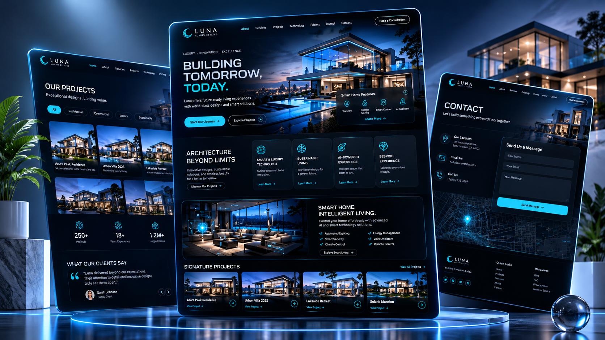

<div align="center">

# 🌙 Luna Glass Estates


### Building Tomorrow. Today.

A futuristic, dark-themed landing page for a luxury smart-glass real estate brand, crafted with **React**, **Tailwind CSS** and **GSAP**.

[](https://react.dev/)
[](https://tailwindcss.com/)
[](https://gsap.com/)


</div>

---

## ✨ Overview

**Luna Glass Estates** is a conceptual landing page for a high-end architecture brand that designs ultra-modern smart-glass mansions. The design blends a deep-navy palette with electric-cyan accents, glassmorphism cards, and smooth scroll-driven motion to convey innovation, luxury, and technology.

> ⚠️ This is a **concept / portfolio project**. The brand, projects, testimonials and contact details are fictional.

## 🎯 Features

- 🎬 **Cinematic hero** with a bold headline, CTA buttons, and a floating smart-home status widget
- 🤝 **"Powered by" partner strip** showcasing technology partners
- 🏛️ **Architecture Beyond Limits**: four feature cards (Smart Glass, AI-Powered Living, Sustainability, Bespoke Experience)
- 🏠 **Smart Home section** highlighting climate, lighting, security, energy, voice and wellness features
- 🖼️ **Signature Projects** gallery with hover interactions
- 🧭 **Interactive process timeline**: Discover → Design → Engineer → Build → Deliver
- 📊 **Animated stats counters** (estates built, countries, sq. ft., satisfaction, years)
- 💬 **Testimonials slider**
- 📩 **Contact form** with a clean, accessible layout
- 📱 **Fully responsive** from mobile to ultra-wide
- ⚡ **Smooth GSAP animations**: ScrollTrigger reveals, staggered entrances, counters

## 🛠️ Tech Stack

| Technology | Purpose |
|------------|---------|
| [React](https://react.dev/) | Component-based UI |
| [Tailwind CSS](https://tailwindcss.com/) | Utility-first styling & theming |
| [GSAP](https://gsap.com/) + ScrollTrigger | Animations & scroll interactions |
| [Vite](https://vitejs.dev/) | Fast dev server & build tool |


## 🚀 Getting Started

### Prerequisites
- Node.js **v18+**
- npm, yarn or pnpm

### Installation

```bash
# 1. Clone the repository
git clone https://github.com/your-username/luna-glass-estates.git

# 2. Navigate to the project
cd luna-glass-estates

# 3. Install dependencies
npm install

# 4. Start the development server
npm run dev
```

Open [http://localhost:5173](http://localhost:5173) in your browser.

### Build for production

```bash
npm run build
npm run preview
```

## 🙌 Acknowledgements

- [GSAP](https://gsap.com/) for the animation toolkit
- [Tailwind CSS](https://tailwindcss.com/) for rapid styling
- [Lucide](https://lucide.dev/) for icons
- Partner logos and imagery are used for demonstration purposes only; all trademarks belong to their respective owners.
